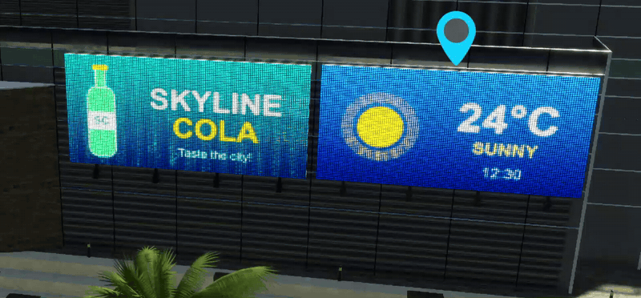
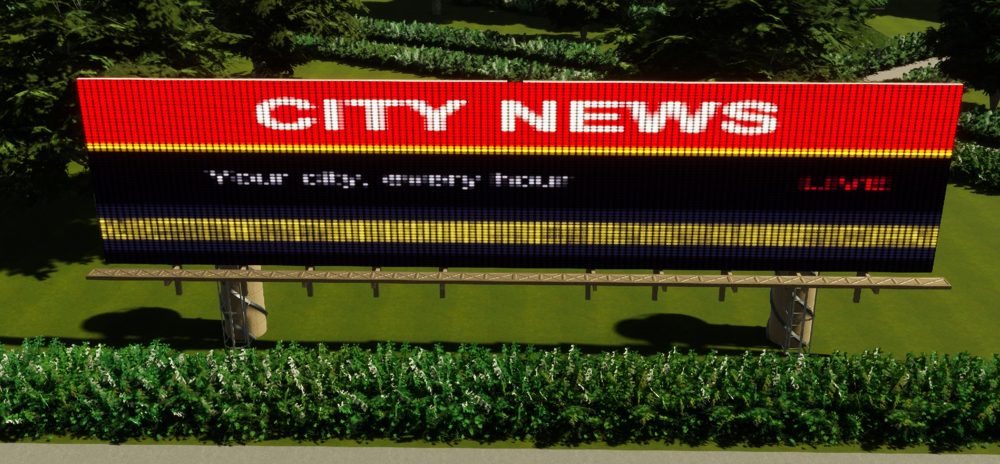
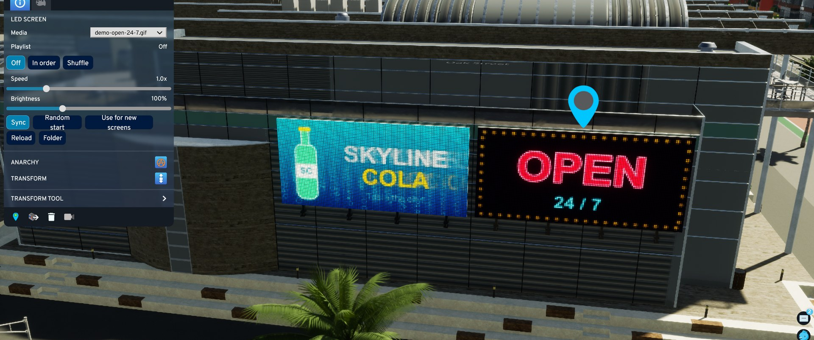
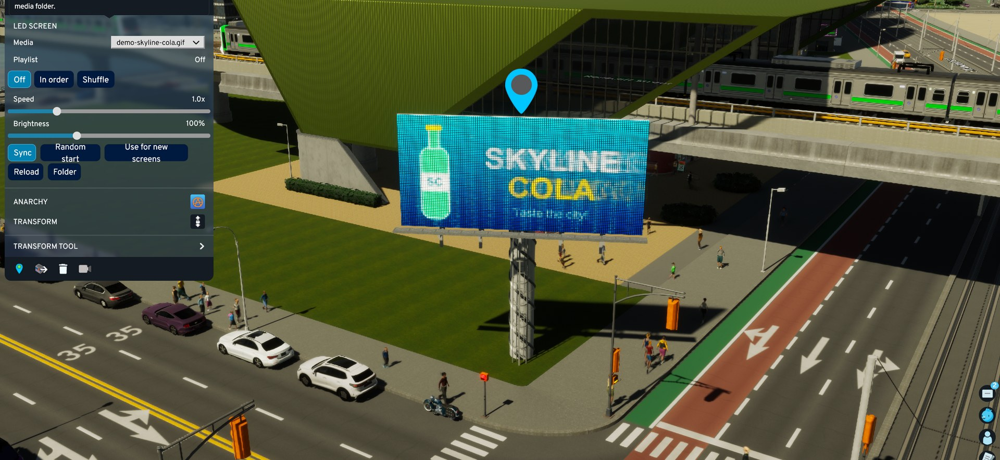
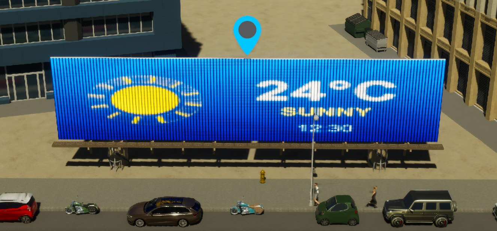

# LED Billboards for Cities: Skylines II

Placeable **animated LED screens and digital billboards** for Cities: Skylines II.
Every screen plays your own media (**GIF, PNG, JPG or video**) and each one can show something different. You can also give a screen a playlist that runs in order or shuffled.



| | |
|---|---|
|  |  |
|  |  |

> ⚠️ **Experimental: use at your own risk and back up your saves.**
>
> Status: work in progress (v0.5.0). Tested on game version 1.6.2 (PC / Xbox app). Available on [Paradox Mods](https://mods.paradoxplaza.com/mods/165337/Windows).
> Built with the help of [Claude](https://claude.com/claude-code).

## Features

- **Placeable LED screen props** in their own **LED Screens** tab under Landscaping:
  - **About 40 props**, each with its own toolbar icon
  - Wall screens (small → huge), posters, portrait screens and ticker strips
  - **Video walls and building facades**, up to about 50 × 20 m
  - Free-standing billboards, street totems and roadside screens
  - **High-pole screens**, from medium up to *Mega* (about 42 × 12 m) and *Ribbon* (3 panels wide, about 37 m), plus portrait and **double-sided** versions. Pole thickness matches the screen size.
  - Round wall screens and double-sided round signs on poles; the image is cropped to the circle
- **Your own media:** drop files into a folder and pick them per screen.
  - Animated **GIF**, with per-screen speed and timing
  - **PNG / JPG** still images
  - **Video**: MP4, WebM, MOV, M4V, AVI, WMV, OGV. Videos loop and are muted.
- **Per-screen controls** in the info panel when you click a screen: media, speed, brightness, sync / random start.
- **Playlists:** a screen can cycle through several files **in order** or **shuffled**, switching every 2–120 seconds.
- **Realistic LED look (optional):** a *Pixelated* or *LED dots* effect with adjustable LED resolution, set for all screens or per screen.
- **Along roads like trees:** street-level screens can fill a road's tree spots in Line/Curve mode, each shuffling your media.
- **Live media folder:** new and changed files show up in game within seconds.
- **Self-lit:** screens keep the same brightness day and night, like a real LED panel. The LED versions of the billboards have no floodlights.
- **Saved with your city:** each screen keeps its media, playlist and settings.
- **Light on performance:** media is shared between screens, off-screen and distant screens aren't drawn, and GIF uploads are spread over several frames.

## Installation

### From source (current)

1. Install the **Modding Toolchain** in-game: *Options → Modding*.
2. Build the project (see [docs/DEVELOPMENT.md](docs/DEVELOPMENT.md)). The build copies the mod into your local mods folder:
   `%USERPROFILE%\AppData\LocalLow\Colossal Order\Cities Skylines II\Mods\LedScreens`
3. Start the game and enable **LED Screens** in your mod list if it isn't already.

### Paradox Mods (recommended)

Subscribe on **[Paradox Mods: LED Billboards (WIP)](https://mods.paradoxplaza.com/mods/165337/Windows)**, or search for *LED Billboards* in the in-game Paradox Mods browser.

## How to use

See **[docs/HOW-TO-USE.md](docs/HOW-TO-USE.md)** for the full guide. The short version:

1. Open **Options → LED Screens → Open media folder** and drop in your `.gif`, `.png`, `.jpg` or video files.
2. Press **Reload media**, or **Reload** in a screen's info panel.
3. In a city, open **Landscaping → LED Screens** and place a screen.
4. **Click the screen.** Its info panel has an **LED Screen** section where you choose the media or set up a playlist.

## Known limitations

- **Props can't be scaled one by one** in CS2, so sizes come from the fixed props in the tab.
- **Screens reuse vanilla billboard models.** The big high-pole screens are built from several vanilla wall panels, and a thin frame may show between them.
- **Videos are shared:** all screens showing the same video play in sync, and speed/offset don't apply to video.
- **Large JPG/PNG files** cause a short hitch the first time they load. Big or long GIFs use more video memory; see the *Quality* settings.
- **Removing the mod:** its screens will be missing from saves that contain them. This hasn't been fully tested yet, so keep a backup save.

## Project layout

```
LedScreens/
  Mod.cs, Setting.cs, LocaleEN.cs   entry point, options menu, English texts
  Components/                       per-screen data saved with the city
  Media/                            GIF decoder, image/video loading, playlist logic
  Prefabs/                          LED prop definition, ad-panel measuring
  Systems/                          prop creation, rendering, info panel section
  UI/LedScreens.mjs                 info panel UI (plain JavaScript, no build step)
docs/
  HOW-TO-USE.md                     player guide
  DEVELOPMENT.md                    building, architecture, debugging
```

## Contributing / feedback

Anyone is welcome to use, modify and build on this mod.

- **Bugs and ideas:** open an [issue](https://github.com/or1995/led-billboards-cs2/issues). If something looks wrong in game, attach a screenshot and `Logs\LedScreens.Mod.log` from the game's user data folder.
- **Code changes:**
  1. Fork the repository and make your changes on a branch.
  2. Build and test in game; see [docs/DEVELOPMENT.md](docs/DEVELOPMENT.md).
  3. Open a pull request describing what changed and how you tested it.
- **Your own version:** you can publish a modified version, as long as you keep the licence notice. Please give it a different name and mod ID so players can tell the two apart.

## License

[MIT](LICENSE): free to use, copy, modify and redistribute, including in other mods, as long as the copyright and licence notice are kept. Provided as is, without warranty.
